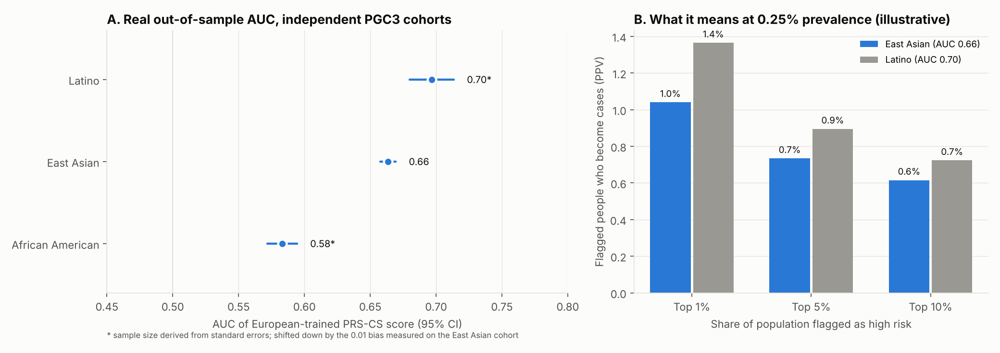
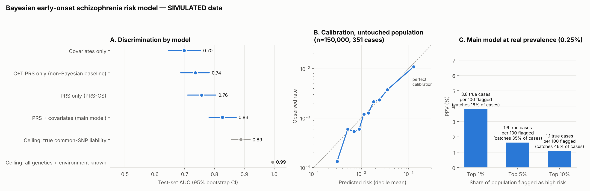

# Bayesian polygenic risk for schizophrenia: PRS-CS on PGC3 with cross-ancestry validation

## Project background

This repository is a reconstruction and extension of a project I worked on during
MITES (The original code was saved in Google Colab under my MIT account, which I can no
longer access. I rebuilt the project using datasets I still had available). 
In the original project, I worked on Bayesian modeling for schizophrenia
risk prediction. My MITES instructor provided the simulated data and the initial
research setup; my work focused on building and working with the Bayesian model.
The simulation results below should not be interpreted as results from real patients.

A Bayesian polygenic score (PRS-CS) was trained on the PGC3 European
schizophrenia GWAS (53,386 cases). 
It was then tested on independent cohorts it never saw:

| Cohort | AUC |
|---|---|
| Latino | **0.70** |
| East Asian | **0.66** |
| African American | **0.58** |

## Pipeline

| Step | Data | Result |
|---|---|---|
| Training GWAS | PGC3 European, 53,386 cases / 77,258 controls (effective N 126,281) | 5.43M clean SNPs |
| Bayesian PRS | Official PRS-CS, 1000 Genomes EUR LD panel, `phi` learned per chromosome | weights for **1,069,518 SNPs** |
| Sanity checks | top weights at known loci (SLC39A8 rs13107325-T, FURIN rs4702-G), 11 of top 100 in the MHC | effect allele confirmed from case vs control frequencies |
| Out-of-sample test | PGC3 East Asian, Latino, African American GWAS + matching 1000 Genomes LD panels | table below |

**Out-of-sample AUC** (no overlap with the training individuals):

| Validation cohort | Sample-size source | AUC [95% CI] |
|---|---|---|
| East Asian (≈14,000 cases / 16,800 controls) | case/control counts | **0.664 [0.658, 0.669]** |
| Latino | derived from SEs, −0.01 bias-corrected | **0.697 [0.680, 0.713]** |
| African American | derived from SEs, −0.01 bias-corrected | **0.583 [0.572, 0.594]** |

**How the AUC is computed without individual data.** For each SNP, `corr(x_j, y) ≈ z_j / √N`.
The score's case–control shift in SD units is then
`d = Σ w_j z_j / √(N_j P(1−P))  /  √(w′ R w)`, using the validation population's LD matrix R,
and `AUC = Φ(d / √2)`. This is the approach of SummaryAUC (Song et al., *Bioinformatics* 2019).

**A workaround for two cohorts.** The African American and Latino files lack per-SNP case
and control counts, so their effective sample size comes from each SNP's standard error.
On the East Asian cohort, which has both, that shortcut ran 0.010 high, so the two results
above are shifted down by that amount.

## How to read this

- **The ancestry pattern is expected.** European-trained weights transfer best to the
  Latino cohorts, which carry substantial European ancestry, and worst to African
  Americans, whose LD patterns differ most. This is the known portability problem of
  polygenic scores. Any real use must report results by ancestry.
- **Low PPV for a rare outcome.** At an illustrative early-onset prevalence of 0.25%, an
  AUC of 0.66 means flagging the top 1% of people catches about 4% of future cases.
  Only about 1 in 100 flagged people would become a case. A genetic score on its own
  can't support screening.
- **Next step: individual-level validation.** For early-onset and psychosis-spectrum
  outcomes, that means the Philadelphia Neurodevelopmental Cohort (dbGaP phs000607,
  controlled access). The label definition is prepared in `real_data/pnc_label.py`.

## Simulation: the full risk model and method checks

**Everything in this section uses simulated data.** The full model combines the PRS with
non-genetic risk factors, and fitting it needs a row per person: genotype score, risk
factors and outcome. Data at that level isn't public. Youth cohorts like the PNC are
controlled access. So the model was built and tested on a simulated population with
realistic genetic architecture, where the right answers are known.

**Full Bayesian risk model** (PyMC logistic regression, simulated test set):

| Model | AUC [95% CI] |
|---|---|
| Risk factors only (family history, sex, cannabis, urbanicity, obstetric) | 0.70 [0.65, 0.75] |
| PRS only — clumping + thresholding | 0.74 [0.69, 0.78] |
| PRS only — PRS-CS (Bayesian) | 0.76 [0.71, 0.81] |
| **PRS + risk factors** | **0.83 [0.78, 0.87]** |

What the simulation shows:
- **The model is well calibrated on people it never saw.** In a held-out simulated
  population (150k people, 351 cases), the AUC was 0.79 and mean predicted risk was 0.25%
  against an observed 0.23%. Calibration held across deciles.
- **The prevalence correction works.** PPV estimated from the case–control test set
  (4.0%) matched the ground-truth population PPV (3.8%).
- **PRS-CS beats raw GWAS effects.** Its posterior effects correlate 0.47 with the true
  effects, against 0.38 for marginal GWAS effects.
- **The sampler converged cleanly:** 4 chains, R-hat ≤ 1.006, bulk ESS > 5,000.
- **The summary-statistics AUC method checks out.** On four simulated validation cohorts,
  it recovered the true individual-level AUC to within 0.01, running 0.00–0.01 high.
  This supports the real-data AUCs above.

The simulated risk-factor effects are illustrative choices. The 0.83 is a property of
the simulation, not an estimate for real patients.

## Files

| File | Purpose |
|---|---|
| `real_data/run_real.sh` (+ `run_chr.sh`, `prep.py`) | PRS-CS run on PGC3 European |
| `real_data/fetch_validation.sh`, `real_data/validate_real.py` | independent-cohort validation |
| `summary_auc.py`, `plot_real.py` | AUC/PPV helpers and the results figure |
| `real_data/output/scz_prscs_weights_all.txt` | the weights (`CHR SNP BP A1 A2 BETA`, per-allele effect of A1) |
| `real_data/pnc_label.py` | psychosis-spectrum label for the PNC |
| `simulate.py`, `prs_cs.py`, `risk_model.py`, `evaluate.py`, `run_pipeline.py`, `plots.py` | simulation: `python run_pipeline.py results && python plots.py results` |
| `validate_summary_auc.py` | simulation check of the summary-statistics AUC method |

## Limitations
- The AUCs are estimated from summary statistics, not measured on individuals.
- No public European schizophrenia GWAS is independent of PGC3, so the score is only tested across ancestries.
- The outcome is adult schizophrenia in case–control samples, not early-onset risk in children.
- No non-genetic risk factors, such as family history or cannabis use, are modeled.
- PGC data were used under PGC terms: no attempt to identify individuals, and the results are polygenic scores derived from published summary statistics.
